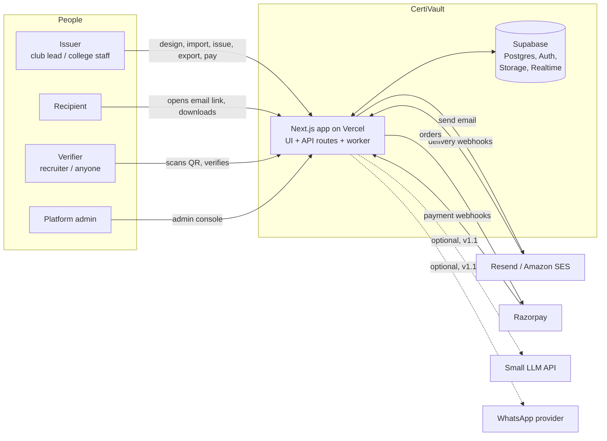
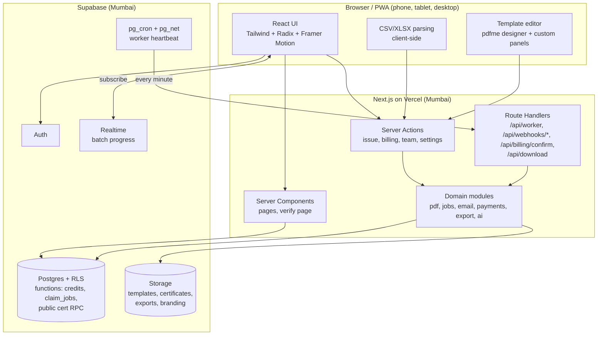
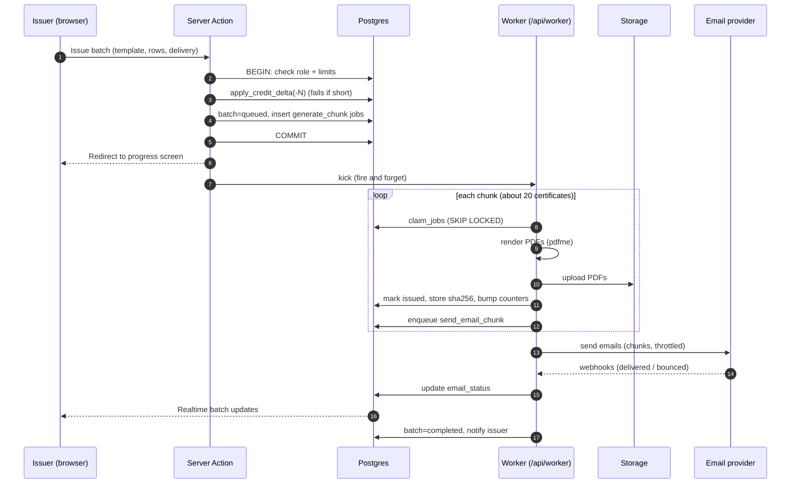
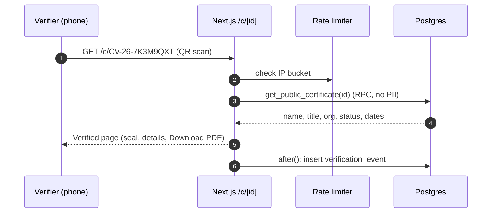
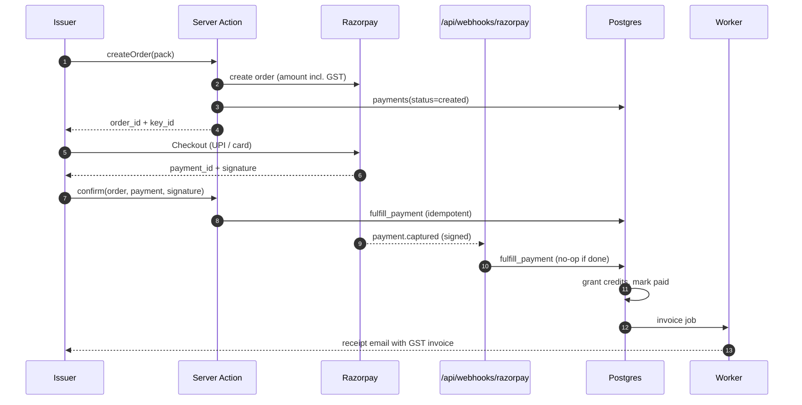
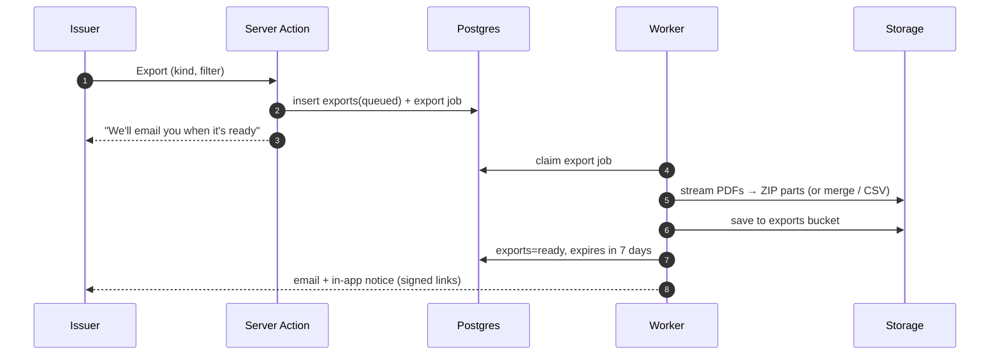
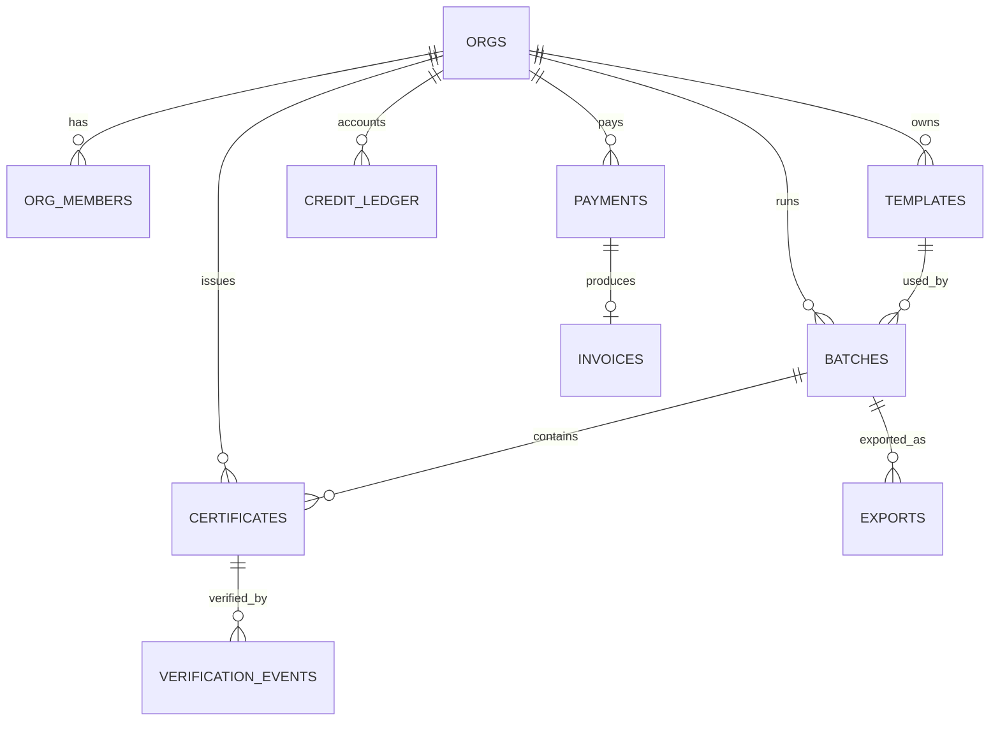
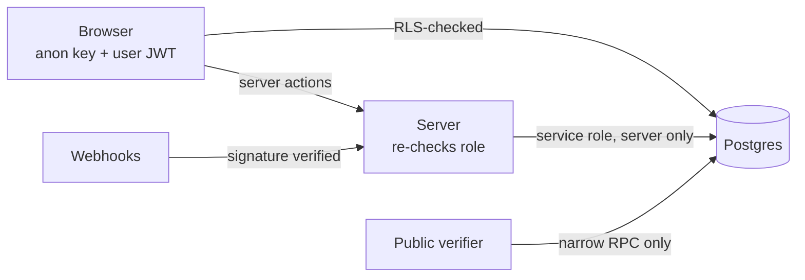
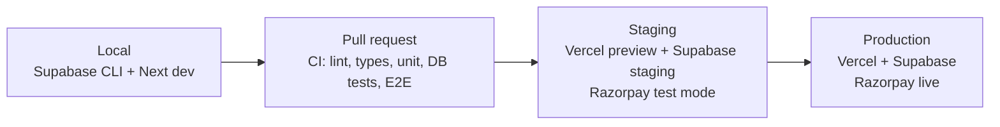

# Architecture: CertiVault (working name)

How the pieces fit together. Pairs with `PRD.md` (what), `TRD.md` (specs), `implementation.md` (how to build).

---

## 1. Architecture at a glance

**Style:** a single Next.js application (modular monolith) on Vercel, backed by one Supabase project. Heavy work runs as small background jobs from a Postgres-backed queue. No always-on servers in v1.0.

**Design goals, in priority order:** trust and correctness → low cost → speed on phones → simplicity to build and operate by one person.

---

## 2. System context



---

## 3. Containers and responsibilities



| Container | Owns | Does not own |
|---|---|---|
| **Browser** | Interaction, parsing, preview, optimistic UI | Secrets, money, final validation |
| **Server Components / Actions** | Authorization checks, validation, orchestration | Long-running work |
| **Worker route** | PDF generation, email sends, exports, invoices | User-facing rendering |
| **Postgres** | Source of truth, RLS, credit atomicity, queue | Business logic that needs third-party calls |
| **Storage** | Files (private buckets) | Metadata |
| **Razorpay / Email provider** | Money movement / delivery | Our state (we reconcile via webhooks) |

---

## 4. Key sequences

### 4.1 Issue a batch



### 4.2 Verify a certificate



### 4.3 Buy credits



### 4.4 Bulk export



---

## 5. Data and storage architecture



**Storage buckets (all private)**

| Bucket | Path | Access |
|---|---|---|
| `branding` | `{org_id}/logo.*`, `signatures/*` | Org members; also read by worker when rendering |
| `templates` | `{org_id}/{template_id}/bg.*`, `thumb.png` | Org members |
| `certificates` | `{org_id}/{batch_id}/{public_id}.pdf`, `superseded/` | Signed URLs only, issued by server |
| `exports` | `{org_id}/{export_id}/part-N.*` | Signed URLs, 7-day expiry |
| `invoices` | `{org_id}/{FY}/{number}.pdf` | Org owner/admin |

**Consistency rules**
- DB is truth; files are derived. A certificate is `issued` only after its PDF exists and its hash is stored.
- Credit balance changes only via `apply_credit_delta`, inside the same transaction as the event that causes them.
- Webhooks and jobs are at-least-once, so every handler is idempotent.

---

## 6. Frontend architecture

```
src/
  app/
    (marketing)/        landing, pricing, legal   (static / ISR)
    (auth)/             login, signup, onboarding
    (app)/app/          authenticated shell: tab bar (mobile) / sidebar (desktop)
      page.tsx          Home
      issue/            wizard (step routes)
      templates/        library + editor
      certificates/     registry, batch detail, certificate detail
      account/          billing, team, organization, profile
    c/[publicId]/       public verification
    verify/             ID entry + QR scan
    admin/              platform admin
    api/                worker, webhooks, billing confirm, download
  components/ui/        design system (buttons, sheets, tab bar, ...)
  features/             templates | issue | certificates | billing | team | org
  server/               pdf | jobs | email | payments | export | ai | auth
  lib/                  supabase clients, zod schemas, utils, constants
```

**Principles**
- Server Components fetch data; client components only where interaction needs it.
- One design-system folder; no feature builds its own button or sheet.
- Wizard steps are routes with drafts saved server-side, so back/forward and app restarts work.
- Adaptive shell: the same routes render a tab bar + sheets on narrow screens and a sidebar + dialogs on wide screens (CSS container/media queries, one component tree).

---

## 7. Security architecture



**Trust boundaries:** (1) browser ↔ server, (2) server ↔ database (service role), (3) public ↔ verification RPC, (4) third-party webhooks ↔ server. Each boundary has an explicit check: JWT + role check, RLS, minimal RPC output, signature verification.

**Threats and controls**

| Threat | Control |
|---|---|
| Cross-organization data access | RLS on all tables; pgTAP tests per policy |
| Fake certificates / impersonating a college | Verified-issuer badge via manual check; org name display; abuse reports; suspension |
| Enumerating certificate IDs | 40-bit random IDs, rate limiting, no list endpoints |
| Credit fraud / double-spend | Atomic SQL function, CHECK constraint, append-only ledger |
| Forged payment webhook | Signature on raw body, event dedupe |
| Malicious uploads | Type/size allow-list, re-encode, private buckets |
| CSV injection | Escaping on export |
| Email abuse (spam via bulk send) | Verified email required, free caps, review of large new-org sends, suppression list |
| Data leak via verify page | RPC returns only public fields; no emails |

---

## 8. Scalability and failure handling

**Capacity (v1.0 targets):** 100 organizations, 50,000 certificates per month, 5,000 verifications per day on the planned tiers. Postgres, storage and Vercel handle this comfortably; the bottleneck is PDF generation throughput.

**Scaling path (only when metrics demand it)**
1. Increase worker concurrency and chunk parallelism.
2. Move PDF generation and exports to a small always-on worker (a ₹500-1,500/month VPS or container) that polls the same `jobs` table. Nothing else changes.
3. Move PDF storage to Cloudflare R2 behind the existing storage interface to eliminate egress cost.
4. Add read replicas or caching for verification if traffic grows.

**Failure modes**

| Failure | Behavior |
|---|---|
| Worker invocation times out mid-chunk | Jobs go stale after 5 min, are re-queued; idempotent generation prevents duplicates |
| Email provider down | Jobs back off and retry; admin flag switches provider |
| Razorpay webhook delayed | Client confirm path fulfills first; webhook is a no-op later |
| Webhook delivered twice | `webhook_events` + idempotent fulfillment |
| Single certificate fails | Marked `failed` with reason, credit refunded, "Retry failed" available |
| Verification DB hiccup | Friendly retry state; never shows "invalid" on a server error |
| Bad template (text overflow) | Pre-issue stress preview; auto-shrink; failure isolated per certificate |

---

## 9. Environments and delivery



- Migrations are SQL files applied by CI (staging first, then production after approval).
- Feature flags (env/DB) gate WhatsApp, AI, approvals, custom domains.
- Observability: Sentry (errors), structured logs, queue-depth and payment-lag alerts, uptime check on `/c/health` and `/api/health`.

---

## 10. Architecture decision records (ADRs)

| # | Decision | Why | Revisit when |
|---|---|---|---|
| 1 | Modular monolith in one Next.js app | Fastest for a solo builder; fewer moving parts | Team grows or worker needs different runtime |
| 2 | Supabase for DB/Auth/Storage/Realtime | One vendor replaces four services; RLS gives strong multi-tenant isolation | Cost or compliance requires self-hosting |
| 3 | Postgres-backed job queue, not a queue service | Free, transactional with business data, simple to debug | > 50 jobs/sec sustained |
| 4 | pdfme for templates and generation | JSON templates, QR support, designer UI exists | Template needs exceed it; fallback pdf-lib |
| 5 | Credits as the billing primitive | Simple to sell and meter; fits clubs and colleges | Per-seat enterprise pricing demands more |
| 6 | Razorpay Orders (one-time) instead of Subscriptions | Annual prepay and packs don't need recurring mandates | Monthly plans are introduced |
| 7 | Link-first email delivery (no attachments by default) | Better deliverability, lower cost, trackable | Customers demand attachments → option in v1.1 |
| 8 | Client-side parsing and OCR | Cuts server cost and latency | Files exceed browser memory (> 10k rows) |
| 9 | Live (uncached) verification reads | Revocation must reflect instantly | Traffic makes caching necessary → tag-based invalidation |
| 10 | No LLM in the core path | Predictable cost and reliability | A feature clearly pays for itself |
| 11 | Phone gets preset quick-edit, full editor on tablet/desktop | Precision layout on a phone is poor UX and costly to build | Usage data shows demand |
| 12 | Mumbai region for compute and DB | Latency and data-residency preference | Expanding beyond India |

---

## 11. What is intentionally left out

Native apps, SSO/SAML, blockchain anchoring, LMS plug-ins, multi-region, microservices, a separate backend service, custom auth, and any AI in issuance. Each can be added later without reworking the core above.
